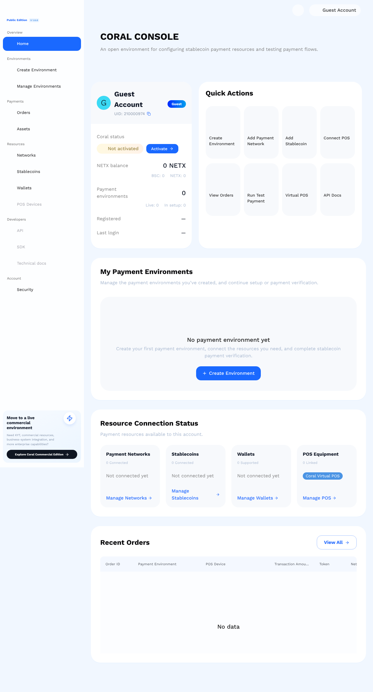
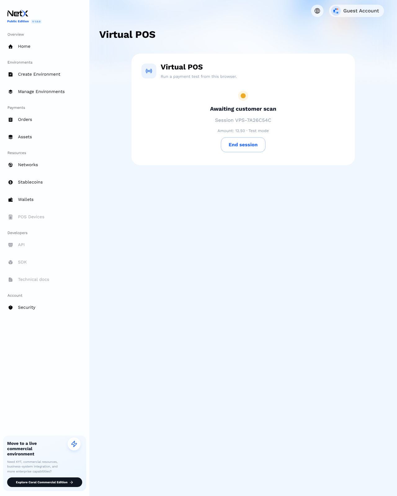
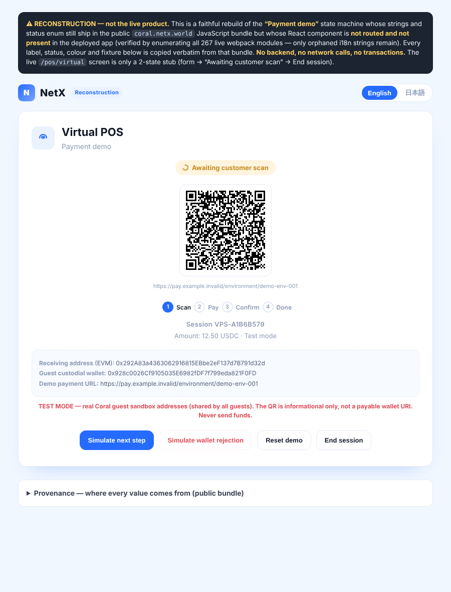
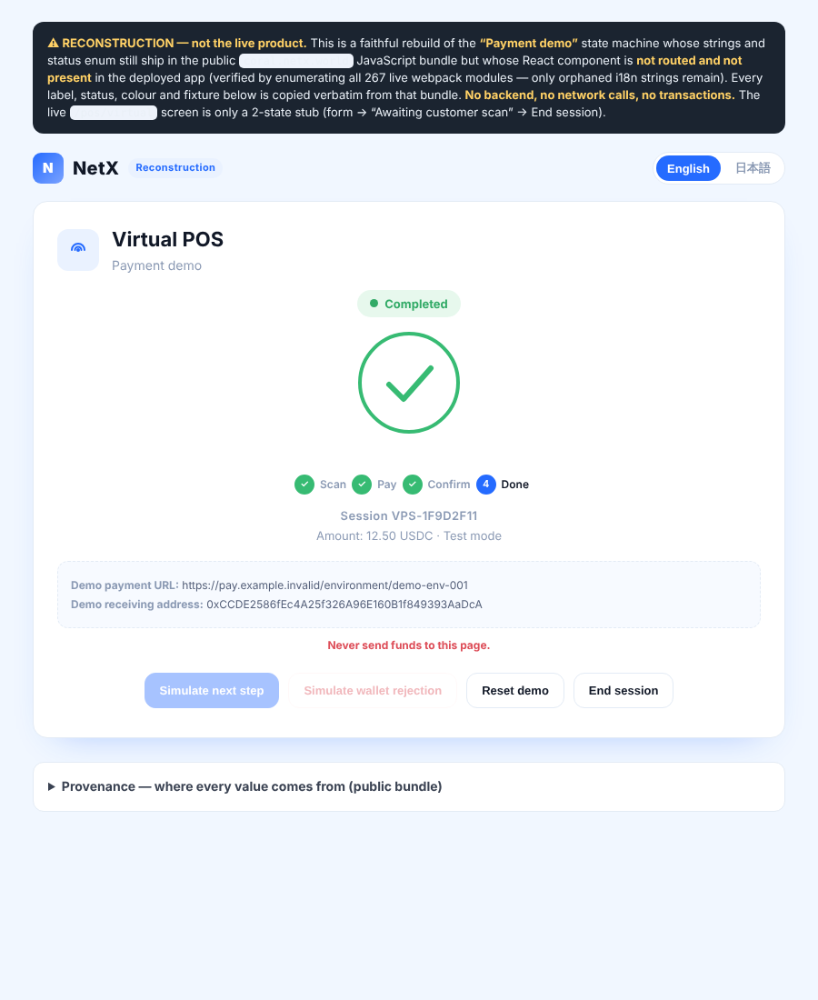
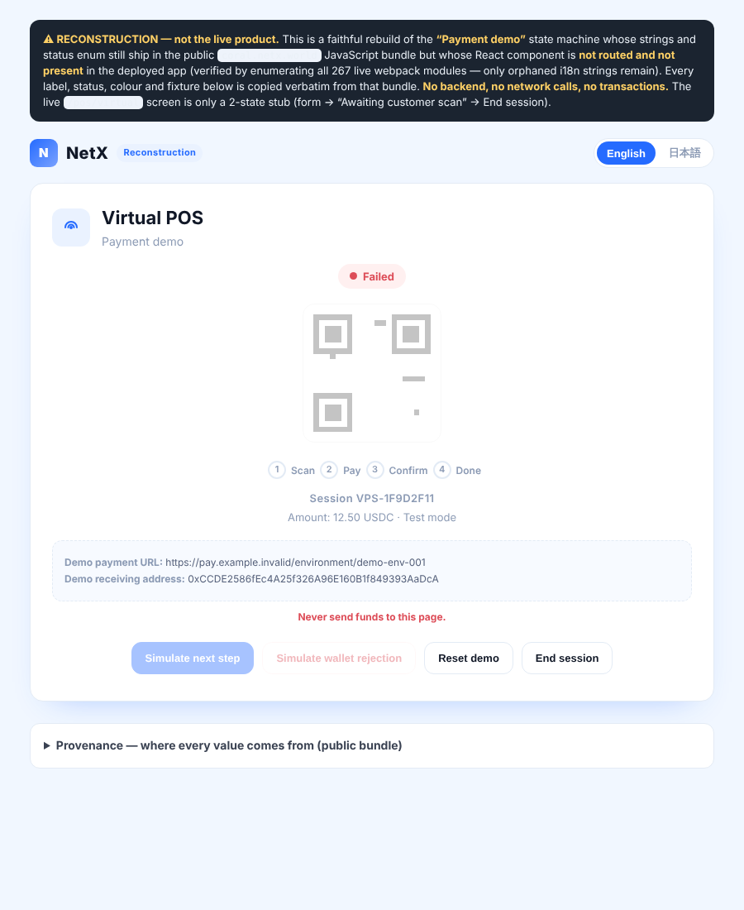
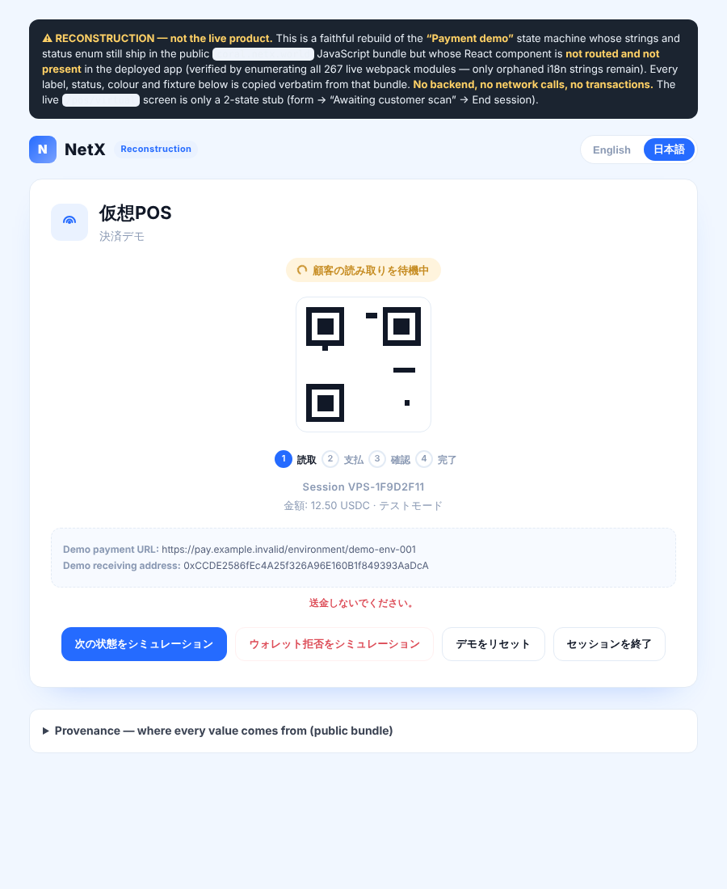

# NetX Coral — análisis, exploración guest y reconstrucción del Virtual POS

> Investigación de `https://coral.netx.world` (NetX Coral, "Public Edition" v1.0.0),
> producto hermano de AgentCity dentro del ecosistema NetX. Todo lo que sigue se
> obtuvo de los assets públicos del sitio y de la función **guest** que el propio
> producto ofrece ("Continue as Guest", datos sintéticos, sin fondos reales).
> No se forzó ningún endpoint restringido.
>
> **Fecha de la investigación: 2026-10-24.**

## 1. Qué es Coral

Consola de **pagos en stablecoin para empresas Web2** ("Connecting Web2 Enterprises
with Web3 Payments"; internamente "Stablecoin Payment Control Center"). Es una
pasarela de cobro, no DeFi: el comercio monta un **Payment Environment** aislado,
le conecta redes, stablecoins, wallets receptoras y dispositivos POS, y obtiene una
**URL de pago dedicada**.

Onboarding que delatan los textos de la UI: **Activate Coral → Connect Coral →
Connect Resources → Dedicated Payment URL**, y luego un **Environment Check** que
verifica que la ruta de pago completa sea ejecutable (errores `INSUFFICIENT_PATH`,
`INVALID_KEY`, `MISSING_FORMAT`).

## 2. Stack y seguridad observables

| Aspecto | Valor |
|---|---|
| Frontend | Next.js (App Router) tras nginx |
| Sesión | JWT HS256 (24 h) en `localStorage["coral.session"]` (zustand persist) + cookie `coral.token` para el middleware SSR |
| CSP | `script-src 'self' 'nonce-…' 'strict-dynamic'`, `frame-ancestors 'none'`, `object-src 'none'`, `base-uri 'self'`, `form-action 'self'` |
| Otras cabeceras | HSTS con `includeSubDomains`, `Referrer-Policy: no-referrer`, `Permissions-Policy` restrictiva, COOP `same-origin` |
| `connect-src` | `rpc.netxscan.io`, BSC (`56.rpc.thirdweb.com`, `bsc-dataseed`), Sepolia, Polygon (`polygon.drpc.org`), Morph, Solana mainnet |

Postura de cabeceras sólida, más propia de producción financiera que de un MVP.

## 3. Superficie de API

Base: `/api/console/v1` (configurable con `NEXT_PUBLIC_API_BASE_URL`).

**REST directo** (solo estas dos familias):

- `POST /auth/{login,register,guest-login,metamask-nonce,metamask-login,refresh-token,logout,bind-email,bind-wallet,unbind-wallet,send-verification-code,forgot-password}`
- `GET /user/{info,netx-balance,guest-wallet}`, `PUT /user/{profile,change-email,change-password}`, `/user/upload-avatar`

**Recursos** (environments, networks, stablecoins, wallets, POS, orders): se sirven
por **Next.js Server Actions** (`callServer` / `createServerReference`), no por REST
público. Rutas como `/environments` o `/orders` devuelven 404 en la API: son rutas
de la UI. Reduce la superficie REST expuesta al cliente.

`POST /auth/guest-login` recibe `{"device_id": "web_<uuid>"}` (el front lo guarda en
`localStorage["coral.device_id"]`).

Además de la consola, Coral documenta una **segunda API, para POS físico**, en otro
host: `api.coral.netx.io` (ver sección 12).

## 4. Hallazgos de la sesión guest

**Auto-provisión.** `GET /user/guest-wallet` devuelve una wallet de login y dos
direcciones de cobro:

| Campo | Valor |
|---|---|
| `wallet_address` | `0x928c0026Cf9105035E6982fDF7f799eda821F0FD` |
| `evm_payment_address` | `0x292A83a4363062916815EBbe2eF137d7B791d32d` |
| `sol_payment_address` | `7VcPhKXedtnce6iWGGvbGLkoEaSMTN4yyUcrGQuBA6zQ` |

Pedidas en **sesiones guest independientes** (device_id distintos), las tres
salieron **idénticas**: son direcciones **sandbox compartidas por todos los guests**,
no custodia por usuario.

**Gate de activación.** `GET /user/netx-balance`:

```
netx_chain_balance: 0  bsc_chain_balance: 0  total_balance: 0
activation_threshold: 5000.00000000  is_activated: false
```

Activar Coral exige **5000 NETX** (saldo NETX + BSC). Hasta entonces
`coral_activated:false` y el entorno queda "In setup".

**Recursos por defecto** (renderizados server-side para el guest):

| Recurso | Contenido |
|---|---|
| Redes | Solana · Polygon (137) · Morph (2818) |
| Stablecoins | USDC y USDT en Solana; USDC y JPYC en Polygon; USDC en Morph (contratos mainnet reales) |
| Wallets | MetaMask |
| POS | 1 "Coral Virtual POS" |

**Ediciones.** Public/Community (la actual) frente a Commercial y Enterprise. En
Community no hay tipos de cambio, ni **KYT screening**, ni órdenes de negocio
vinculadas. El propio bundle incluye el texto *"Real authentication and payment APIs
are not configured. No demo data or transactions are enabled in production."*

**Capa developer vacía.** `/sdk` y `/docs` son stubs: *"This route is wired into the
application shell. The feature module and API contract can be added here…"*



## 5. Virtual POS en vivo: stub de dos estados

`/pos/virtual` solo tiene un formulario (monto + USD/USDC/USDT) y, al enviarlo, una
tarjeta "Awaiting customer scan" con un botón **End session**. El id se genera en el
navegador (`"VPS-" + crypto.randomUUID().slice(0,8).toUpperCase()`).

Con todo el tráfico capturado, **"Create payment session" no dispara ninguna
petición al backend**: no se crea orden, no hay QR, no hay transición de estado.



## 6. La "Payment demo" no está desplegada

El bundle contiene el vocabulario de una demo más rica (`virtualPos.demoPay`,
`advance: "Simulate next step"`, `decline: "Simulate wallet rejection"`,
`restart: "Reset demo"`, aviso *"This is a state-machine demonstration, not a
transaction. Never send funds to this page."*) y el enum
`PENDING_PAYMENT · PAYING · CHAIN_CONFIRMING · COMPLETED · FAILED · EXPIRED`.

Enumerando el **registro completo de módulos webpack en runtime** tras cargar todas
las rutas de la consola (267 módulos):

| Módulo | Contenido | ¿Componente con la máquina de estados? |
|---|---|---|
| 13695 | Todas las cadenas de la demo (EN + JA) | No: es solo i18n |
| 74668 | `CHAIN_CONFIRMING:"status-info"`, etc. | No: badge de estado de **Orders** |

Ningún módulo conecta `advance`/`decline` a un `onClick`. El componente se eliminó
por tree-shaking (o nunca entró en este despliegue): **no hay nada que montar**.
Los únicos consumidores reales del enum son el filtro y los badges de Orders.

## 7. Reconstrucción

Con el material que sí sobrevivió en el bundle se reconstruyó la demo como página
autónoma. **Verbatim del bundle:** etiquetas EN/JA, enum de estados, controles,
aviso, clases y colores `.status-*` (del CSS servido), paleta `--coral-*`, formato
de id `VPS-` y fixture `pay.example.invalid/environment/demo-env-001`.
**Reconstruido:** solo el orden de transiciones (no sobrevivió ningún array de
secuencia): Awaiting scan → Paying → Chain confirming → Completed; rechazo → Failed;
inactividad (45 s) → Expired.

Incluye:

- Selector EVM / Solana que muestra la dirección sandbox real correspondiente.
- **QR real** (`qrcode-generator` 1.4.4) verificado decodificándolo con jsQR.
- **Salvaguarda:** el QR codifica una URL `https` informativa
  (`…/demo-env-001?session=…&mode=test&network=…&token=…&amount=…&to=<dirección>`),
  **nunca** un URI pagable `ethereum:` / `solana:`; `pay.example.invalid` es un TLD
  reservado que no resuelve.

| Escaneo (EVM) | Completed | Rechazo | 日本語 |
|---|---|---|---|
|  |  |  |  |

Dos versiones en `coral/`:

- `vpos-demo-reconstruction.html` — uso local, con el lockup de marca original y
  banner "RECONSTRUCTION — not the live product".
- `vpos-demo-public.html` — la que se publica: **sin marca NetX** ("VPOS Recon ·
  Independent · Unaffiliated") y con aviso explícito de no afiliación.

## 8. Despliegue de prueba en Cloudflare

- Cuenta de Cloudflare conectada por MCP; **Worker** de un solo archivo generado
  con `scripts/coral/build-worker.mjs` (HTML gzip + base64, descomprimido con
  `DecompressionStream`; cabeceras `no-store` y `x-robots-tag: noindex, nofollow`).
- Host **no predecible**: nombre del Worker = token aleatorio de 128 bits y
  subdominio `workers.dev` de la cuenta también aleatorio (el inicial, derivado del
  nombre de la cuenta, se liberó con `DELETE /accounts/{id}/workers/subdomain`,
  porque la API no permite renombrarlo: `PUT` devuelve 409).
- La URL **no se registra en el repositorio** a propósito.
- Pasos de API usados: `PUT /accounts/{id}/workers/subdomain`,
  `PUT /accounts/{id}/workers/scripts/{name}` (multipart, `main_module: worker.js`),
  `POST /accounts/{id}/workers/scripts/{name}/subdomain {"enabled": true}`.
- Ojo: el nombre no se adivina, pero no es un secreto fuerte (Cloudflare ve el
  hostname y la página envía `Referer` a cdnjs al cargar la librería QR). Para
  privacidad real haría falta Cloudflare Access o auth en el Worker.

## 9. ¿Sirve para probar el flujo completo?

| Quieres probar… | ¿Sirve? |
|---|---|
| UI / máquina de estados del Virtual POS, demos | Sí: la reconstrucción |
| Flujo de **pago real** de Coral end-to-end | No: en la edición pública el cobro está gated (5000 NETX / Commercial) y el POS real es un stub |
| Flujo de **misión AgentCity** real | Sí, pero es otro sistema: `scripts/agent-city/` |

## 10. Scripts (`scripts/coral/`)

Salidas en `runs/coral/` (ignorado por git). Playwright se resuelve del proyecto o,
si no está instalado, de la copia preinstalada del contenedor cloud.

| Script | Qué hace |
|---|---|
| `verify-demo.mjs [ruta\|url]` | 10 checks: direcciones EVM/SOL, QR decodificado e informativo (no pagable), máquina de estados, rechazo, japonés, sin errores de consola. Vale para el HTML local, el público o la URL desplegada. |
| `guest-vpos-flow.mjs` | Login guest nativo + sesión en `/pos/virtual`; reporta cuántas peticiones dispara la creación (0) y guarda el tráfico con los JWT redactados. |
| `probe-modules.mjs` | Enumera el registro webpack en vivo y clasifica los módulos con el vocabulario de la demo. |
| `build-worker.mjs [html]` | Genera `runs/coral/worker.js` para subir como Worker de módulo. |
| `crawl-inventory.mjs` | Recorrido acotado (sin login + guest) de la consola; genera `runs/coral/inventory.md` y guarda texto/capturas por página (ver sección 11). |

```bash
node scripts/coral/verify-demo.mjs                              # reconstrucción local
node scripts/coral/verify-demo.mjs coral/vpos-demo-public.html  # versión publicada
node scripts/coral/verify-demo.mjs https://<host>.workers.dev/  # despliegue
node scripts/coral/guest-vpos-flow.mjs
node scripts/coral/probe-modules.mjs
node scripts/coral/build-worker.mjs
```

## 11. Inventario de rutas (crawl anónimo + guest)

Recorrido acotado con `scripts/coral/crawl-inventory.mjs`: mismo origen, 700 ms entre
páginas, tope de 45/pasada, siguiendo enlaces internos un salto. Dos pasadas — sin
login y con el modo guest del propio producto. No sondea endpoints ocultos; solo
visita lo que la sesión guest está autorizada a ver. Texto y capturas por página en
`runs/coral/crawl/` (ignorado por git).

**Sin login:** todas las rutas de la consola hacen **redirect 307 → `/login`**. Solo
son públicas `/login`, `/signup` (email + código de verificación + password; o
MetaMask; o guest) y `/forget_password` (email + código + nueva contraseña).

**Con guest** (18 páginas alcanzables):

| Ruta | Resuelve a | Nota |
|---|---|---|
| `/` | — | dashboard (Not activated) |
| `/login` | `/` | ya autenticado |
| `/pos`, `/pos/virtual` | — | lista POS / POS virtual (stub de 2 estados) |
| `/orders` | — | órdenes (vacío) |
| `/networks` | — | Solana · Polygon · Morph |
| `/wallets` | — | MetaMask |
| `/tokens` | — | USDC/USDT/JPYC |
| `/stablecoins` | `/tokens` | alias |
| `/environments` | — | lista de entornos (vacía) |
| `/environments/new` | `/create_environment` | alias |
| `/create_environment` | — | flujo de alta, **gated** (Not activated) |
| `/assets` | — | balances on-chain de ejemplo |
| `/connect_resources` | — | **stub** ("wired into the application shell") |
| `/add_pos` | — | alta de POS físico + **spec de API** (ver abajo) |
| `/security` | — | perfil / bind email·wallet |
| `/sdk`, `/docs` | — | **stubs** |

### Hallazgos nuevos del crawl

- **API de POS físico, en un host distinto.** `/add_pos` documenta una integración
  con base **`https://api.coral.netx.io`** (≠ la consola `coral.netx.world/api/console/v1`):

  | Método | Ruta | Descripción |
  |---|---|---|
  | POST | `/v1/pos/register` | registra el dispositivo con POS ID + secreto |
  | POST | `/v1/pos/heartbeat` | reporta estado online y mantiene la conexión |
  | POST | `/v1/pos/sessions` | escanea el código de pago de un entorno y crea sesión de cobro |
  | POST | `/v1/pos/sessions/{id}/confirm` | confirma el escaneo y espera la liquidación on-chain |

  Un POS físico "no está atado a un entorno concreto"; se integra vía estas APIs en
  desarrollo y el comercio comprueba la conexión tras el go-live.
- **`/assets`** ("Asset Management") lista balances on-chain de muestra: USDC 3.0587
  (Solana), USDT 2.6262 (Solana), USDC 2.939 (Polygon), JPYC 88.2585 (Polygon), con
  "USD valuation unavailable" (sin tipos de cambio en Community Edition).
- **`/create_environment`** es el flujo real de alta (View → Activate → Connect →
  Environment check → Dedicated payment URL → POS payment → View orders), pero muestra
  "Not activated": *"After activation you can start connecting payment resources."*
- Rutas que resultaron ser **stubs** vacíos: `/sdk`, `/docs`, `/connect_resources`.

## 12. API de POS físico (`api.coral.netx.io`)

Documentada **a partir de lo que Coral publica** en su propia página `/add_pos` y de
los textos del bundle. **No se llamó a la API** (no hay credenciales y, como se ve
abajo, el host ni siquiera resuelve). Las descripciones son verbatim (Coral las
sirve en EN y JA).

**Contexto.** Es un host **distinto** del de la consola: la API de POS vive en
`api.coral.netx.io` (dominio **`netx.io`**), mientras que la consola es
`coral.netx.world/api/console/v1` (dominio **`netx.world`**). El SDK anunciado es
`coral-pos · iOS / Android / embedded`. Nota de integración:

> "A physical POS is not bound to a specific environment. Integrate with the APIs
> below during development. After go-live, the merchant checks the connection on
> this page."

Es decir, un POS físico **no se ata a un entorno**; en su lugar escanea el *dedicated
payment code* de cualquier entorno para crear la sesión de cobro.

**Contrato publicado** (base `https://api.coral.netx.io`):

| Método | Ruta | Descripción (verbatim) |
|---|---|---|
| POST | `/v1/pos/register` | Register the device with POS ID and secret |
| POST | `/v1/pos/heartbeat` | Report online status and keep the connection alive |
| POST | `/v1/pos/sessions` | Scan any environment's dedicated payment code to create a collection session |
| POST | `/v1/pos/sessions/{id}/confirm` | Confirm the scan result and wait for on-chain completion |

El frontend solo publica **método + ruta + descripción**: no declara esquemas de
request/response ni cabeceras de auth. Lo que sí se infiere de la UI:

- **Alta.** El formulario "Register Device" tiene **POS Name** (requerido, con
  `maxLength`), **Vendor** y **Model**, y el botón "Register and Generate Secret".
  El texto dice que al registrar el dispositivo recibe un **POS ID y un secreto de
  un solo uso** ("one-time secret"). De ahí el `register` → devuelve `{ POS ID,
  secret }`, y el resto de llamadas se autentican con ese par.
- **Ciclo de vida:** `register` (una vez) → `heartbeat` (keepalive periódico) →
  `sessions` (escanea el código de pago del entorno → sesión de cobro) →
  `sessions/{id}/confirm` (confirma el escaneo y espera la liquidación on-chain).
  Mapea 1:1 con la máquina de estados del Virtual POS
  (`Awaiting scan → Paying → Chain confirming → Completed`).

### El host no está desplegado (verificado)

Resolución DNS pasiva, calibrada contra hosts conocidos (sin llamar a ningún
endpoint de la API):

| Host | Resuelve |
|---|---|
| `coral.netx.world` (consola) | sí → `18.180.50.157` (HTTP 307) |
| `netx.io` (dominio padre) | sí → `198.145.10.86` |
| **`api.coral.netx.io`** | **no — NXDOMAIN** |
| `coral.netx.io` | no — NXDOMAIN |

El DNS del entorno funciona (resuelve la consola, el dominio padre y terceros), pero
`api.coral.netx.io` **no existe en DNS público**. Sumado a que el formulario de alta
es un **stub cliente** (genera el POS ID con `crypto.randomUUID()`, sin tocar la red),
la conclusión es que esta API de POS está **documentada pero no operativa** en la
edición pública: es un contrato planificado/aspiracional, coherente con que
`/sdk`, `/docs` y `/connect_resources` sean stubs y con el aviso del propio producto
("Real authentication and payment APIs are not configured").

## 13. Qué no está en el repo (a propósito)

- JWT de guest, cookies, `device_id` y capturas de red sin redactar.
- El JavaScript/HTML/CSS descargado de `coral.netx.world` (código de terceros);
  los scripts lo vuelven a obtener en vivo cuando hace falta.
- La URL del despliegue.

## 14. Pendiente / ideas

- Explorar el flujo de activación (stake de 5000 NETX) — toca dinero real, requiere
  decisión explícita.
- Capa de acceso (Cloudflare Access o token) si el despliegue se va a compartir.
- Revisar periódicamente si Coral publica la "Payment demo" o el SDK
  (`probe-modules.mjs` lo detectaría).
